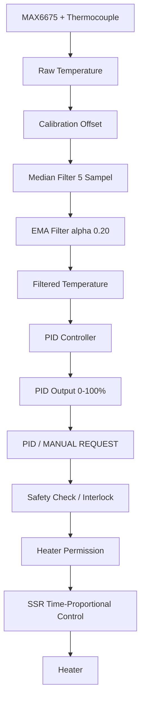
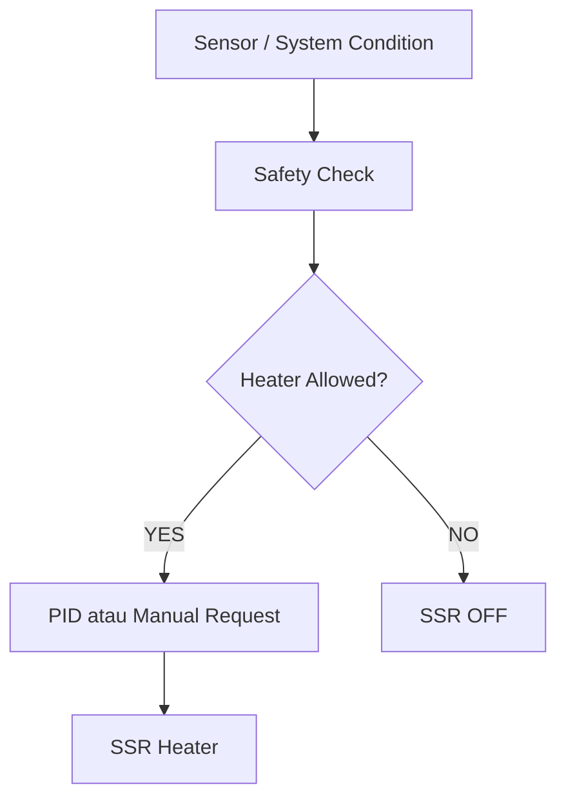
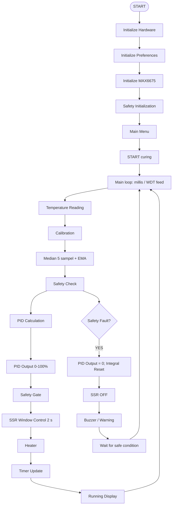
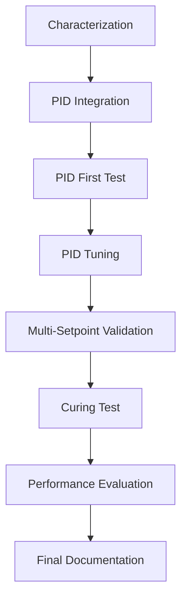

# Oven Curing Controller

Oven Curing Controller adalah sistem kendali temperatur berbasis ESP32 untuk proses curing. Firmware menggunakan thermocouple melalui MAX6675, kontrol PID, SSR heater, fan relay, OLED 128x64, rotary encoder, timer, calibration offset, penyimpanan Preferences/NVS, serta safety interlock.

Tujuan utama sistem adalah menjaga temperatur oven terhadap setpoint menggunakan kontrol PID. Nilai PID saat ini adalah nilai awal pengujian; tuning dan validasi performa final masih berlangsung.

## 1. PROJECT OVERVIEW

- **Tujuan sistem:** mengatur heater oven berdasarkan setpoint temperatur dan durasi curing.
- **Fungsi oven curing:** menyediakan proses pemanasan terkontrol selama waktu yang ditentukan pengguna.
- **Kontrol temperatur:** temperatur aktual dibaca dari thermocouple, dikalibrasi, difilter, lalu digunakan sebagai input PID.
- **PID Controller:** menghitung permintaan daya heater dari error antara setpoint dan temperatur terfilter.
- **Monitoring:** temperatur, setpoint, status heater, sisa timer, dan status error sensor ditampilkan melalui OLED.
- **Safety system:** memblokir heater jika sensor tidak valid atau temperatur mencapai batas over-temperature.
- **User interface:** rotary encoder digunakan untuk navigasi menu, pengaturan parameter, start/stop, dan mode manual.

Performa PID final, stabilitas, overshoot, dan hasil tuning belum dapat disimpulkan dari firmware saja.

## 2. SYSTEM ARCHITECTURE



Safety memiliki prioritas lebih tinggi daripada permintaan PID maupun permintaan manual. Jika `heaterAllowed` bernilai `false`, output SSR dipaksa OFF.

## 3. HARDWARE

| Komponen | Implementasi firmware |
|---|---|
| ESP32 DevKit / ESP32-WROOM-32 | Target board `ESP32 Dev Module` |
| OLED 0.96 inch 128x64 I2C | Adafruit SSD1306 + Adafruit GFX, alamat I2C `0x3C` |
| Rotary encoder dengan push button | Input navigasi dan editing parameter |
| MAX6675 | Interface thermocouple melalui serial clock/chip select/data out |
| Thermocouple | Sensor temperatur yang dibaca MAX6675 |
| SSR heater | Dikendalikan oleh GPIO heater; komentar firmware menyebut melalui NPN transistor switch |
| Fan relay | Relay dengan konfigurasi active-low |
| Buzzer | Output indikator input, penyimpanan, start, selesai, dan safety |
| Driver BC457 | Tidak disebut secara eksplisit di source code; firmware hanya menyebut NPN transistor switch pada jalur SSR |

## 4. PIN CONFIGURATION

| Component | Pin | Function |
|---|---:|---|
| OLED SDA | GPIO21 | I2C data |
| OLED SCL | GPIO22 | I2C clock |
| Rotary CLK | GPIO18 | Encoder phase A, interrupt input |
| Rotary DT | GPIO19 | Encoder phase B, interrupt input |
| Rotary SW | GPIO23 | Push button, `INPUT_PULLUP` |
| SSR Heater | GPIO25 | Kontrol SSR melalui NPN transistor switch |
| Fan Relay | GPIO26 | Kontrol relay fan; active-low (`LOW=ON`, `HIGH=OFF`) |
| MAX6675 SCK | GPIO32 | Serial clock |
| MAX6675 CS | GPIO27 | Chip select |
| MAX6675 SO | GPIO34 | Serial data out; input-only GPIO ESP32 |
| Buzzer | GPIO33 | Output driver active/passive buzzer |

OLED menggunakan `OLED_RESET = -1`, sehingga tidak memakai pin reset GPIO terpisah.

## 5. USER INTERFACE

UI menggunakan carousel horizontal pada menu utama dan menu System. Rotary encoder adalah interface utama:

- **CW:** next
- **CCW:** previous
- **PRESS:** select/confirm

Navigasi menu menggunakan indeks melingkar (circular navigation). Timeout tidak ada aktivitas UI adalah 10 detik untuk layar yang relevan; sistem kembali ke HOME atau RUNNING sesuai status proses.

### MAIN MENU

```text
START
SETPOINT
TIMER
PID
MANUAL
CALIBRATION
SYSTEM
```

`START` berubah menjadi opsi stop saat proses sedang berjalan. Menu `MANUAL` dikunci ketika curing sedang berjalan.

### SYSTEM MENU

```text
SENSOR
DEVICE
VERSION
RISET
BACK
```

- **SENSOR:** menampilkan temperatur, status sensor, dan status MAX6675.
- **DEVICE:** menampilkan MCU ESP32 dan UI OLED 128x64.
- **VERSION:** menampilkan identitas firmware dan versi pada layar Version (`1.3.0`).
- **RISET:** konfirmasi pengembalian user settings ke nilai reset firmware.
- **BACK:** kembali ke Main Menu.

## 6. TEMPERATURE MEASUREMENT

Alur pemrosesan temperatur adalah:

```text
MAX6675
  |
Raw Temperature
  |
Calibration Offset
  |
Median Filter (5 sampel valid)
  |
EMA Filter (alpha = 0.20)
  |
Filtered Temperature untuk PID dan Safety
```

### MAX6675

Firmware membaca data serial 16-bit MAX6675 setiap 250 ms. Nilai temperatur menggunakan 12-bit temperatur dengan resolusi `0.25 degC/LSB`. Bit error, nilai `0xFFFF`, atau nilai `0x0000` dianggap sebagai sensor error/disconnected.

### Calibration Offset

Offset ditambahkan ke temperatur mentah:

```text
calibratedTemperature = rawTemperature + calibrationOffset
```

### Median Filter

Median dihitung dari maksimal 5 sampel temperatur terkalibrasi yang valid untuk mengurangi pengaruh outlier sebelum EMA.

### EMA Filter

EMA mengurangi noise dan fluktuasi pembacaan. Nilai firmware adalah `EMA_ALPHA = 0.20`:

```text
filtered = 0.20 * median + 0.80 * previous_filtered
```

Pada pembacaan valid pertama, filter diinisialisasi langsung dengan nilai median. `currentTemperature` yang digunakan PID dan safety adalah temperatur setelah EMA.

## 7. PID CONTROLLER

PID digunakan untuk mengatur output heater berdasarkan error:

```text
Error = Setpoint - Temperature
```

Komponen PID:

- **Kp - Proportional Gain:** merespons error saat ini.
- **Ki - Integral Gain:** mengakumulasi error untuk mengurangi steady-state error.
- **Kd - Derivative Gain:** merespons perubahan temperatur. Implementasi menggunakan perubahan input temperatur.

### Initial/default PID parameters

Nilai awal yang digunakan ketika key NVS belum tersedia adalah:

| Parameter | Nilai awal |
|---|---:|
| Kp | 2.50 |
| Ki | 0.50 |
| Kd | 1.00 |

Nilai tersebut merupakan nilai awal pengujian dan belum dapat dianggap sebagai parameter tuning final.

## 8. PID EXECUTION

- PID dihitung menggunakan `millis()` dengan interval target `250 ms`.
- `dt` dihitung dari selisih waktu komputasi sebelumnya dalam detik.
- Output dibatasi pada rentang `0.0-100.0%`.
- Integral dibatasi pada rentang `0.0-100.0`.
- Anti-windup menahan akumulasi integral saat output sudah `100%` dan error positif, atau output `0%` dan error negatif.
- Pada first run, input PID diinisialisasi dari temperatur saat ini sehingga derivative tidak memakai nilai temperatur lama yang tidak valid.
- Saat sistem tidak running, heater tidak diizinkan, sensor error, atau safety bukan `SAFETY_OK`, output PID dan integral di-reset ke nol serta first-run protection diaktifkan kembali.
- Saat proses dihentikan, output PID dan integral juga di-reset ke nol.

## 9. SSR HEATER CONTROL

Output PID tidak digunakan sebagai PWM frekuensi tinggi. Firmware menggunakan **time-proportional/window control** dengan window `2000 ms` atau `2 detik`.

| PID output | Perkiraan ON-time dalam window |
|---:|---:|
| 0% | 0 detik |
| 25% | 0.5 detik |
| 50% | 1 detik |
| 75% | 1.5 detik |
| 100% | 2 detik |

Pada awal setiap window, ON-time di-snapshot dari `pidOutput`. Metode ini sesuai untuk heater dengan respons termal lambat, mengurangi kebutuhan switching frekuensi tinggi, dan sesuai untuk pengendalian SSR heater.

## 10. SAFETY SYSTEM

Safety adalah interlock yang memiliki prioritas lebih tinggi daripada PID dan manual request.



Heater dimatikan dan `heaterAllowed` dibuat `false` jika:

- thermocouple terdeteksi disconnect atau MAX6675 mengembalikan data error;
- temperatur invalid, yaitu `sensorError`, nilai `<= -900 degC`, atau `NaN`;
- temperatur mencapai `MAX_SAFE_TEMP = 150.0 degC`;
- proses berada pada kondisi STOP atau belum running, kecuali request manual pada layar manual;
- startup atau kondisi lain memanggil `emergencyPinsSafeState()`/`setHeater(false)`.

Over-temperature dilatch dan baru pulih ketika temperatur turun sampai `145.0 degC` atau lebih rendah (`150 - 5 degC`). Fault sensor memerlukan 5 pembacaan valid berturut-turut untuk menghapus flag `sensorError`, sementara safety check tetap menentukan izin heater.

Saat safety fault aktif, `computePID()` menetapkan output dan integral ke nol, kemudian `updateOutputs()` memaksa heater OFF. Buzzer digunakan sebagai indikator safety: pola over-temperature memiliki prioritas lebih tinggi daripada sensor error. Buzzer juga memberi indikator start, selesai, penyimpanan setting, dan press encoder.

## 11. MANUAL MODE

`MANUAL` digunakan untuk pengujian atau kontrol manual heater dan fan saat sistem tidak running. Heater manual tetap melewati pemeriksaan `heaterAllowed`, sensor error, dan safety state; mode ini tidak dapat membypass safety interlock. PID tidak mengambil alih ketika manual aktif karena menu manual hanya dapat digunakan saat `systemRunning == false`.

## 12. TIMER

Timer menentukan durasi proses curing. Nilai timer diatur melalui menu `TIMER` dengan rotary encoder dalam menit:

- default: `30` menit;
- batas bawah praktis pada editing: `1` menit;
- batas atas: `999` menit;
- CW menambah 1 menit dan CCW mengurangi 1 menit;
- PRESS menyimpan nilai ke Preferences/NVS.

Saat START dikonfirmasi, durasi menit dikonversi ke detik dan proses mulai dengan `curingTotalSeconds = timerDurationMinutes * 60`. Selama running, sisa waktu dihitung dari `millis()`. Ketika waktu habis, sistem menghentikan proses, mematikan heater dan fan, membunyikan pola finish, lalu kembali ke HOME.

## 13. CALIBRATION

```text
Raw Temperature
      |
Calibration Offset
      |
Calibrated Temperature
      |
Median / EMA Processing
```

Calibration offset diubah melalui menu `CALIBRATION` menggunakan rotary encoder:

- range: `-10.0 degC` sampai `+10.0 degC`;
- step perubahan: `0.1 degC`;
- PRESS menyimpan offset ke Preferences/NVS;
- setelah tersimpan, OLED menampilkan konfirmasi `CALIBRATION SAVED`.

## 14. PREFERENCES / NVS

Firmware membuka namespace Preferences `oven`. Parameter persistent berikut disimpan:

| Parameter | Key NVS | Default saat key belum ada |
|---|---|---:|
| Setpoint | `setpoint` | 60.0 degC |
| Durasi timer | `timer_dur` | 30 menit |
| Proportional gain | `pid_kp` | 2.50 |
| Integral gain | `pid_ki` | 0.50 |
| Derivative gain | `pid_kd` | 1.00 |
| Calibration offset | `cal_offset` | 0.0 degC |

Setting yang disimpan tersedia kembali setelah ESP32 restart melalui `loadSettings()`.

## 15. RISET / RESET SETTINGS

Menu `RISET` mengembalikan user settings ke nilai reset firmware dan menyimpannya kembali ke NVS. Fungsi ini tidak menghapus firmware, tidak mengubah konfigurasi hardware atau pin, dan tidak menghapus fungsi sistem.

Nilai yang di-reset:

| Parameter | Nilai reset |
|---|---:|
| Setpoint | 60.0 degC |
| Timer | 30 menit |
| Kp | 1.00 |
| Ki | 0.00 |
| Kd | 0.00 |
| Calibration offset | 0.0 degC |

## 16. RUNNING DISPLAY

Saat `SCREEN_RUNNING`, OLED diperbarui secara dinamis dan menampilkan:

- `TEMP`: temperatur terfilter aktual, atau `---` saat sensor error;
- `SET`: setpoint saat safety normal;
- `STATUS`: `SENSOR ERROR` atau `OVER TEMP` saat fault;
- `HEATER`: persentase output PID saat diizinkan, atau `OFF` saat safety tidak mengizinkan;
- `TIME`: sisa waktu curing dalam format `MM:SS`.

Header menampilkan status `HEATING`. Tampilan HOME menampilkan temperatur, setpoint, dan status `HEATING` atau `IDLE`.

## 17. CONTROL FLOW



Urutan aktual pada setiap loop adalah input UI, update UI/timer, update display, kemudian `readTemperatureSensor()`, `checkSafetySystem()`, `computePID()`, `updateOutputs()`, `updateBuzzer()`, dan CSV logging. Safety diperiksa sebelum PID dan kembali diterapkan sebagai gate pada output heater.

## 18. OVEN CHARACTERIZATION

Characterization awal dilakukan sebelum tuning PID.

### Heating Test

| Parameter | Data |
|---|---:|
| Temperatur | 36.20 degC -> 104.79 degC |
| Durasi | 159 s |
| Perubahan temperatur | 68.59 degC |
| Average heating rate | sekitar 25.88 degC/menit |

### Cooling Test

| Parameter | Data |
|---|---:|
| Temperatur | sekitar 102.95 degC -> sekitar 58.42 degC |
| Durasi | sekitar 226 s |
| Perubahan temperatur | sekitar 44.53 degC |
| Average cooling rate | sekitar 11.8 degC/menit |

Data ini menunjukkan heating relatif cepat, cooling lebih lambat, adanya thermal inertia, dan respons termal yang tidak sepenuhnya linear. Karakteristik tersebut perlu diperhatikan saat tuning PID. Data ini adalah characterization awal, bukan hasil performa PID final.

## 19. PID TUNING STATUS

- PID controller sudah diimplementasikan.
- Parameter default adalah initial value, bukan parameter tuning final.
- Tuning final dilakukan berdasarkan hasil pengujian aktual.
- Pengujian dilakukan bertahap mulai dari setpoint rendah sebelum temperatur operasi yang lebih tinggi.
- Parameter final belum boleh diklaim sebelum data pengujian tersedia.

Parameter evaluasi tuning:

- Rise Time
- Overshoot
- Settling Time
- Steady-State Error
- Temperature fluctuation
- Stability
- Heater output behavior

## 20. TESTING PLAN

1. Sensor Test
2. Safety Test
3. Manual Heater Test
4. Heating Characterization
5. Cooling Characterization
6. PID First Test
7. PID Tuning
8. Multi-Setpoint Test
9. Curing Process Test
10. Final Stability Evaluation

Pengujian PID dimulai pada setpoint rendah sebelum menuju temperatur operasi yang lebih tinggi.

## 21. DATA LOGGING

Firmware mengirim logging CSV melalui Serial pada baud rate `115200`. Baris data dikirim setiap 1 detik dengan format:

```text
TIME,TEMP,SETPOINT,PID_OUTPUT,HEATER,SAFETY
```

Kolom yang dikirim oleh `logCSVData()` adalah:

| Kolom | Arti |
|---|---|
| `TIME` | Waktu sejak boot dalam detik (`millis()/1000`) |
| `TEMP` | Temperatur terfilter dalam degC |
| `SETPOINT` | Setpoint dalam degC |
| `PID_OUTPUT` | Output PID dalam persen |
| `HEATER` | Status heater, `1` ON atau `0` OFF |
| `SAFETY` | `OK`, `SENSOR_ERR`, atau `OVER_TEMP` |

Firmware tidak menyediakan contoh hasil pengujian pada source code.

## 22. CURRENT DEVELOPMENT STATUS

### Hardware

- ESP32 DevKit: ✅
- OLED: ✅
- Rotary Encoder: ✅
- MAX6675: ✅
- Thermocouple: ✅
- SSR Heater: ✅
- Fan Relay: ✅
- Buzzer: ✅

### Firmware

- Main Menu: ✅
- System Menu: ✅
- Setpoint: ✅
- Timer: ✅
- Calibration: ✅
- Manual Mode: ✅
- Safety System: ✅
- PID Controller: ✅
- SSR Window Control: ✅
- NVS: ✅
- Oven Characterization: ✅ data characterization awal tersedia sebagai dokumentasi
- PID Tuning: ⏳
- Final Validation: ⏳

## 23. PROJECT ROADMAP



## 24. DEVELOPMENT NOTES

- SSR heater menggunakan time-proportional control dengan window 2 detik.
- PID tidak boleh membypass safety.
- Heater selalu berada di bawah safety interlock.
- Temperatur PID menggunakan temperatur yang telah melewati median filter dan EMA filter.
- Rotary encoder merupakan interface utama.
- Firmware menggunakan pendekatan non-blocking berbasis `millis()` untuk loop, pembacaan sensor, PID, timer, UI, buzzer, dan logging.
- Parameter user disimpan menggunakan Preferences/NVS.
- Nilai PID saat ini belum merupakan hasil tuning final.
- Firmware header menyatakan versi `1.3.0`, sedangkan teks layar boot pada source code masih menampilkan `v1.2.0`.
- Watchdog timer dikonfigurasi dengan timeout 5 detik dan di-feed pada setiap loop.
